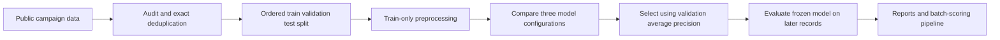

# Customer Response Modeling and Temporal Evaluation

A reproducible machine-learning prototype for pre-call response prediction using the [UCI Bank Marketing dataset](https://archive.ics.uci.edu/dataset/222/bank+marketing). The project focuses on data quality, target-leakage exclusions, ordered validation, and model behavior under temporal distribution shift.

It includes preprocessing pipelines, model comparison, segment-level diagnostics, and a batch-scoring command-line tool.

## Data and experiment design

- **41,188 source records**, with 12 exact duplicate rows removed.
- **70/15/15 source-order split**, preserving UCI's documented chronological ordering.
- **28,823 training**, **6,176 validation**, and **6,177 evaluation** records.
- Excludes post-call `duration`, which is unavailable at the intended pre-call prediction time.
- Handles the `pdays=999` never-contacted sentinel, numeric imputation, scaling, and categorical encoding.
- Fits all learned preprocessing only on training data.
- Compares logistic regression against two histogram gradient-boosting configurations, selecting the model using validation average precision.



## Measured results

Logistic regression was selected using validation average precision. The same fitted model was evaluated on the final ordered block.

| Evaluation metric | Value |
|---|---:|
| Average precision | 0.4464 |
| Constant-score average-precision reference | 0.3845 |
| ROC-AUC | 0.5747 |
| Brier score | 0.2762 |
| Precision among highest-scored 10% | 0.4676 |
| Top-decile lift | 1.2163 |

Performance on later records is modest, and the probability estimates have substantial error there. The positive rate rises from **5.575% in training** to **38.449% in evaluation**, demonstrating a material change between the data blocks. The experiment does not establish production readiness or causal campaign impact.

Read [RESULTS.md](RESULTS.md), [full metrics](artifacts/metrics.json), [data-quality report](artifacts/data_quality.json), and [segment diagnostics](artifacts/segment_metrics.csv).

## Quick start

Use **Python 3.12**, the tested version.

```bash
git clone https://github.com/WhiteDevil377/customer-response-modeling.git
cd customer-response-modeling
python3 -m venv .venv
source .venv/bin/activate
python -m pip install -r requirements.txt
python train.py
python verify.py
python score.py example_customers.csv --output predictions.csv
```

On Windows, activate the environment with `.venv\Scripts\activate`.

`train.py` downloads the public source archive if it is absent, trains the candidate pipelines, writes evaluation reports, and saves the selected pipeline to `artifacts/model.joblib`. Data archives, generated model binaries, and local environments are excluded from Git.

`example_customers.csv` contains five historical feature rows from the public benchmark, without outcome labels or call durations. Scoring requires the generated model and the accompanying `modeling.py` module. It returns an estimated response probability and a validation-threshold decision for each row.

The demonstration decision threshold maximizes validation F1. No real campaign cost function or production decision policy was supplied.

## Repository contents

| File | Purpose |
|---|---|
| `train.py` | Download data, audit, split, compare models, evaluate, and save the pipeline |
| `modeling.py` | Shared feature handling and learned preprocessing |
| `score.py` | Batch scoring for CSV input |
| `verify.py` | Checks for duration exclusion, valid probabilities, unknown categories, schema errors, and ordered split boundaries |
| `artifacts/` | Recorded metrics, predictions, data-quality audit, and segment reports |
| `RESULTS.md` | Human-readable account of the measured experiment |

## Interpreting the metrics

Average precision is the scikit-learn non-interpolated precision-recall summary, not classification accuracy or trapezoidal PR-AUC. A constant-score reference equals the positive rate of the evaluated block. ROC-AUC measures ranking; Brier score measures probability error; top-decile lift compares the response rate in the highest-scored 10% against the block's overall rate.

The local inference report times batches of 1,000 rows. It excludes model loading and network latency and is not a single-request or deployment throughput benchmark.

## Limitations and next experiments

- Source order approximates chronology; there is no exact timestamp column, and a split boundary can divide contacts from the same day.
- Client identifiers are unavailable, so repeated-client independence cannot be verified. Exact deduplication does not resolve that issue.
- Class prevalence and economic features change across the ordered blocks. One holdout is not a complete rolling-window study.
- Some features describe the current contact. The intended scoring moment is after its schedule and campaign count are known, before the outcome and duration are known.
- No external-dataset evaluation, probability recalibration, online experiment, or production deployment was performed.

Useful extensions include rolling-origin validation, a separately held-out calibration period, a decision threshold based on an explicit cost function, and comparison on another dataset.

## Sources and attribution

Moro, S., Rita, P., and Cortez, P. (2014). *Bank Marketing*. UCI Machine Learning Repository. [Dataset DOI](https://doi.org/10.24432/C5K306).

- [Official dataset and license](https://archive.ics.uci.edu/dataset/222/bank+marketing)
- [Public archive](https://archive.ics.uci.edu/static/public/222/bank+marketing.zip)
- [Average precision definition](https://scikit-learn.org/stable/modules/generated/sklearn.metrics.average_precision_score.html)
- [Histogram gradient boosting documentation](https://scikit-learn.org/stable/modules/generated/sklearn.ensemble.HistGradientBoostingClassifier.html)

The public dataset is credited under [CC BY 4.0](https://creativecommons.org/licenses/by/4.0/). Example rows and derived data reports retain that attribution. Third-party libraries retain their respective licenses.
